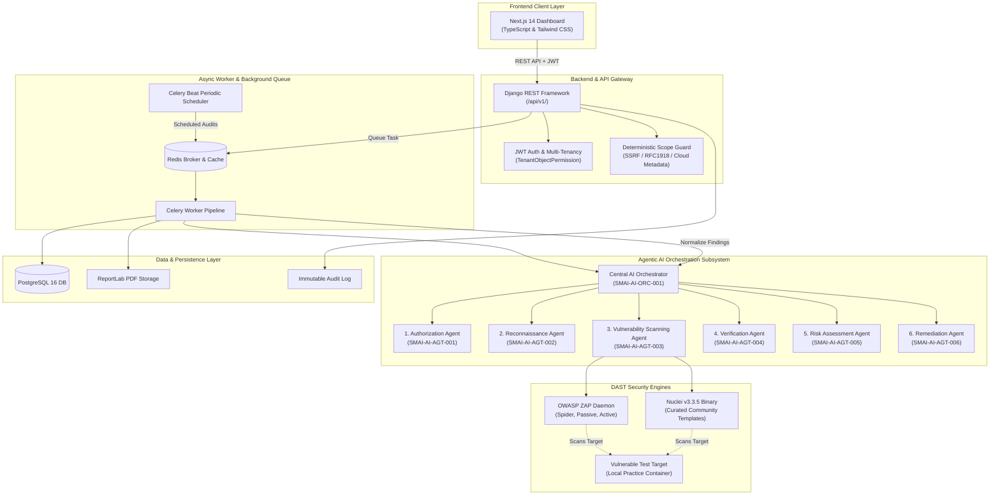

# SecureMind AI 🛡️🤖
### Agentic AI-Powered Web Application Security Analysis & Remediation Platform

[](LICENSE)
[](https://www.python.org/)
[](https://www.djangoproject.com/)
[](https://nextjs.org/)
[](TESTING_REPORT.md)

**Document ID:** `SMAI-SRS-001`  
**Version:** 1.0.0 Baseline  
**Product Status:** Production-Ready MVP  

---

## 1. Product Overview

**SecureMind AI** is a defensive cybersecurity platform that coordinates established vulnerability scanning engines (**OWASP ZAP** and **Nuclei**) with **One Central AI Orchestrator** and **Six Specialized AI Agents**.

Unlike legacy vulnerability scanners that produce bloated, unfiltered PDF dumps or standalone AI chatbots disconnected from actual execution, SecureMind AI establishes an end-to-end authorized assessment pipeline:

1. **Asset Ownership Verification:** Cryptographic DNS TXT and HTTP well-known challenge tokens guarantee users only scan targets they legitimately own or possess explicit legal authorization to assess.
2. **Deterministic Security Guardrails:** Network-level SSRF filters reject internal loopbacks, private RFC1918 subnets, cloud metadata endpoints (`169.254.169.254`), and IPv6-mapped addresses prior to scanner dispatch.
3. **Dual DAST Scanning Engines:** Real-world execution of OWASP ZAP (spidering, passive inspection, safe active tests) and Nuclei v3.3.5 (curated vulnerability templates).
4. **Agentic AI Orchestration:** One Central Orchestrator coordinates six specialized agents to analyze technology stacks, verify vulnerabilities using raw HTTP evidence, score real-world business risks, and generate framework-specific developer remediation code diffs.
5. **Continuous Security Monitoring:** Scheduled recurring audits (daily, weekly, monthly), notification dispatch, and automated assessment diffing to track recurring vs. resolved vulnerabilities over time.
6. **Audit-Grade PDF Reports:** ReportLab-powered PDF generation providing C-level metrics summaries, finding evidence transcripts, and actionable remediation diffs.

---

## 2. Technology Stack

| Layer | Technology | Purpose |
|---|---|---|
| **Frontend** | Next.js 14 (App Router), TypeScript, Tailwind CSS, Lucide Icons | Responsive multi-tenant dashboard, live telemetry polling, remediation center |
| **Backend API** | Python 3.12, Django 5.0, Django REST Framework 3.15, SimpleJWT | RESTful versioned endpoints (`/api/v1/`), multi-tenancy, RBAC, audit trail |
| **Database** | PostgreSQL 16 | Relational storage for tenants, assets, scans, findings, evidence, audit logs |
| **Task Queue** | Celery 5.4, Redis 7.2 | Asynchronous scan pipeline coordination, Celery Beat periodic scheduler |
| **DAST Engines** | OWASP ZAP Daemon, Nuclei v3.3.5 (ProjectDiscovery) | Target spidering, passive header analysis, active template-based scanning |
| **AI Layer** | Google Gemini (`google-genai` SDK), Strict Pydantic v2 Schemas | 1 Central Orchestrator + 6 Specialized Agents with offline deterministic fallback |
| **Reporting** | ReportLab 4.2 | Audit-ready PDF report generation (`%PDF-1.4`) with executive charts and code diffs |
| **Infrastructure** | Docker, Docker Compose | Containerized microservices, isolated worker environments, no host socket exposure |

---

## 3. High-Level Architecture



---

## 4. The 6 Specialized AI Agents

SecureMind AI enforces strict separation of concerns across its AI architecture. Each agent inherits from `BaseAgent`, validates inputs/outputs against strict Pydantic v2 schemas, and features sanitized prompt boundaries:

1. **Authorization Agent (`SMAI-AI-AGT-001`):** Evaluates asset verification status, authorization expiration dates, requested scan profiles, and human-in-the-loop requirements.
2. **Reconnaissance Agent (`SMAI-AI-AGT-002`):** Fingerprints web technologies (frameworks, programming languages, web servers) and evaluates mandatory security headers.
3. **Vulnerability Scanning Agent (`SMAI-AI-AGT-003`):** Configures scanner execution profiles, enforces rate limits, and monitors ZAP and Nuclei engine execution.
4. **Verification Agent (`SMAI-AI-AGT-004`):** Inspects raw HTTP requests, responses, and payload reflections to filter out false positives and assign confidence ratings (0.0 to 1.0).
5. **Risk Assessment Agent (`SMAI-AI-AGT-005`):** Translates raw technical findings into understandable risk explanations with CVSS vector analysis and business impact scoring.
6. **Remediation Agent (`SMAI-AI-AGT-006`):** Generates actionable, framework-specific code diffs (Django, Express, Spring, etc.) and links to official OWASP remediation cheat sheets.

---

## 5. Quick Start (Development & Local Evaluation)

### Prerequisites
- Docker & Docker Compose v2+
- Python 3.12+ (for local host testing)
- Node.js 18+ (for frontend development)

### Step 1: Clone and Configure Environment
```bash
git clone https://github.com/securemind-ai/securemind-platform.git
cd securemind-platform

# Copy environment template
cp .env.example .env
```

### Step 2: Launch Platform Services
```bash
docker compose up -d --build
```
This starts:
- `backend` on http://localhost:8000
- `frontend` on http://localhost:3000
- `postgres` on port 5432
- `redis` on port 6379
- `celery_worker` & `celery_beat`
- `zap` daemon on port 8080
- `test_target` (safe training container) on http://localhost:9090

### Step 3: Run Database Migrations & Create Superuser
```bash
docker compose exec backend python manage.py migrate
docker compose exec backend python manage.py createsuperuser
```

### Step 4: Access the Application
- **Frontend Dashboard:** http://localhost:3000
- **Swagger / OpenAPI Documentation:** http://localhost:8000/api/docs/
- **Django Administration:** http://localhost:8000/admin/
- **Vulnerable Practice Application:** http://localhost:9090

---

## 6. Running the Automated Test Suite

The test suite runs with 100% pass rate across 33 comprehensive test cases covering authentication, multi-tenancy, asset ownership verification, SSRF blocking, scanner normalization, AI agent schemas, ReportLab PDF generation, continuous monitoring, and end-to-end acceptance:

```bash
# Activate virtual environment
source .venv/bin/activate

# Execute all 33 tests
PYTHONPATH=backend USE_SQLITE=True python backend/manage.py test tests
```

Output:
```
Ran 33 tests in 33.965s
OK (failures=0, errors=0, skipped=0)
```

---

## 7. Documentation Directory

For in-depth operational and architectural details, refer to the comprehensive documentation suite:

- [System Architecture Document (SAD)](file:///home/temesgen/Documents/SECUREMIND%20AI/system_architecture_document.md) — Detailed SRS alignment and data flows.
- [Deployment Guide](file:///home/temesgen/Documents/SECUREMIND%20AI/DEPLOYMENT_GUIDE.md) — Production SaaS & Self-Hosted installation instructions.
- [User Guide](file:///home/temesgen/Documents/SECUREMIND%20AI/USER_GUIDE.md) — End-user dashboard walkthrough, asset verification, and remediation tracking.
- [API Documentation](file:///home/temesgen/Documents/SECUREMIND%20AI/API_DOCUMENTATION.md) — Complete REST API reference with OpenAPI schemas.
- [AI Agent Design](file:///home/temesgen/Documents/SECUREMIND%20AI/AI_AGENT_DESIGN.md) — 1 Orchestrator + 6 Agents specifications and prompt defenses.
- [Scanner Integration](file:///home/temesgen/Documents/SECUREMIND%20AI/SCANNER_INTEGRATION.md) — OWASP ZAP & Nuclei coordination and deduplication.
- [Testing Report](file:///home/temesgen/Documents/SECUREMIND%20AI/TESTING_REPORT.md) — Detailed test results and UAC verification matrix.
- [Security Review](file:///home/temesgen/Documents/SECUREMIND%20AI/SECURITY_REVIEW.md) — Threat modeling, SSRF defenses, and container breakout hardening.
- [Changelog](file:///home/temesgen/Documents/SECUREMIND%20AI/CHANGELOG.md) — Release notes and version history.
