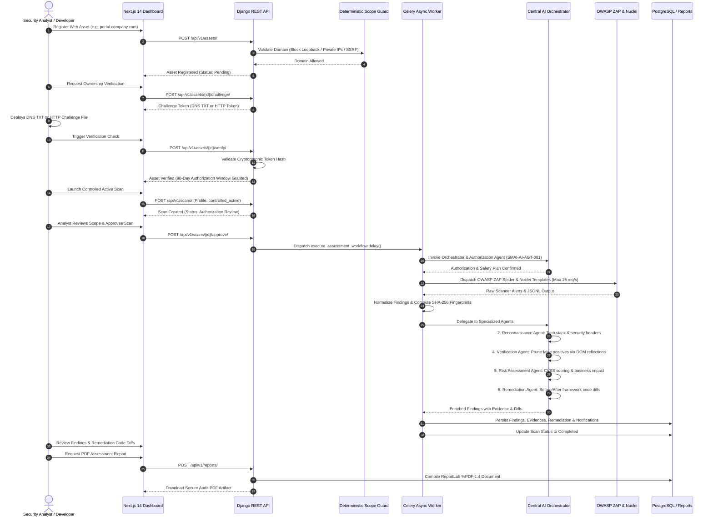
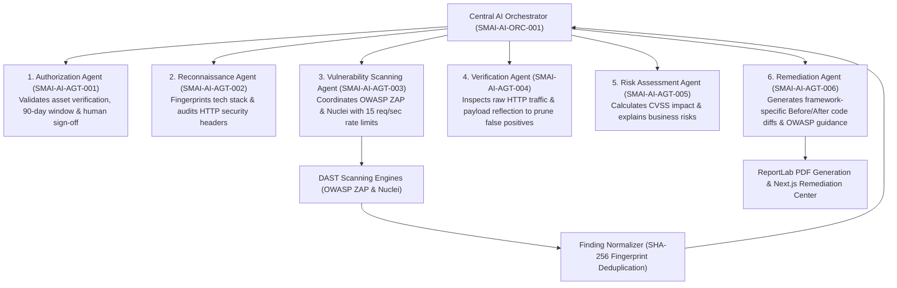

# SecureMind AI 🛡️🤖
### Agentic AI-Powered Web Application Security Analysis & Remediation Platform

[](LICENSE)
[](https://www.python.org/)
[](https://www.djangoproject.com/)
[](https://nextjs.org/)
[](TESTING_REPORT.md)
[](TESTING_REPORT.md)

**Document ID:** `SMAI-SRS-001`  
**Version:** 1.0.0 Baseline  
**Product Status:** Production-Ready MVP Baseline  
**GitHub Repository:** [https://github.com/temesgenzelalem/Securemind-ai](https://github.com/temesgenzelalem/Securemind-ai)

---

## 1. Product Overview & Core Philosophy

**SecureMind AI** is an enterprise-grade defensive cybersecurity platform that bridges established vulnerability scanning engines (**OWASP ZAP** and **Nuclei**) with **One Central AI Orchestrator** and **Six Specialized AI Agents**.

Unlike legacy vulnerability scanners that produce bloated, unfiltered PDF dumps or standalone chatbots disconnected from execution, SecureMind AI establishes an authorized, evidence-backed assessment lifecycle:

1. **Deterministic Pre-Scan Authorization:** Cryptographic DNS TXT and HTTP challenge tokens ensure users only assess web applications they legally own or possess explicit authorization to test.
2. **Network-Level SSRF Protection:** Pre-scan socket filters deterministically reject internal loopback targets, private RFC1918 subnets, cloud metadata endpoints (`169.254.169.254`), and IPv6-mapped addresses.
3. **Dual DAST Scanning Engines:** Real-world coordination of OWASP ZAP (spidering, passive inspection, controlled active scans) and Nuclei v3.3.5 (curated vulnerability templates).
4. **Agentic AI Orchestration:** One Central Orchestrator coordinates six specialized agents to fingerprint technology stacks, verify vulnerabilities using raw HTTP evidence, calculate real-world business risks, and generate framework-specific developer remediation code diffs.
5. **Continuous Security Monitoring:** Scheduled recurring audits (daily, weekly, monthly), notification alerts, and automated assessment diffing to track recurring vs. resolved vulnerabilities over time.
6. **Audit-Grade PDF Reports:** ReportLab-powered `%PDF-1.4` compiler generating executive metrics summaries, raw evidence transcripts, and actionable code remediation diffs.

---

## 2. How SecureMind AI Works (Step-by-Step Lifecycle)



---

## 3. Complete Project Modules Inventory

The SecureMind AI codebase is divided into **13 distinct, cohesive modules** across the backend, frontend, scanning engines, and infrastructure:

### Backend Django Applications (10 Modules in `backend/apps/`)

| # | Module Name | Path | Architectural Responsibilities |
|---|---|---|---|
| **1** | **`core`** | `backend/apps/core/` | Abstract `BaseModel` (UUID primary keys, `created_at`, `updated_at`), management commands (`wait_for_db`, `seed_demo_data`), and platform-wide utility functions. |
| **2** | **`authentication`** | `backend/apps/authentication/` | Custom `User` model, 5 hierarchical security roles (`platform_admin`, `org_admin`, `security_analyst`, `developer`, `viewer`), JWT authentication via SimpleJWT, token refresh, profile endpoints, password management, and active organization context switching. |
| **3** | **`organizations`** | `backend/apps/organizations/` | Multi-tenancy subsystem: `Organization`, `Project`, and `Membership` models, cross-tenant isolation enforcement (`TenantObjectPermission`), member invitations, and organization switching. |
| **4** | **`assets`** | `backend/apps/assets/` | Web application asset registry, RFC1035 domain normalization, cryptographic ownership verification (`AuthorizationChallenge` supporting DNS TXT and HTTP well-known token challenges), 90-day authorization window, granular scope rules (`ScopeRule`), and deterministic SSRF protection (`TargetSafetyValidator`). |
| **5** | **`scans`** | `backend/apps/scans/` | Scan lifecycle management (`Scan`), scanner execution telemetry (`ScannerExecution`), scan profiles (`passive`, `controlled_active`, `comprehensive`), human-in-the-loop analyst sign-off, async Celery workflow (`execute_assessment_workflow`), continuous recurring assessment schedules (`ScanSchedule`), assessment comparison diffing (`ScanComparisonService`), and notifications (`AssessmentNotification`). |
| **6** | **`findings`** | `backend/apps/findings/` | Centralized vulnerability repository (`Finding`), raw HTTP evidence capture (`Evidence`), severity levels (`critical`, `high`, `medium`, `low`, `informational`), and normalization engine (`FindingNormalizerService` with SHA-256 fingerprint deduplication). |
| **7** | **`orchestrator`** | `backend/apps/orchestrator/` | Central AI Orchestrator (`OrchestratorEngine`), assessment workflow state machine (`WorkflowState`), agent telemetry tracking (`AgentExecution`), multi-provider LLM abstraction (`LLMClient`), prompt injection boundary sanitization, and the 6 specialized AI agents with Pydantic v2 schemas. |
| **8** | **`remediation`** | `backend/apps/remediation/` | Actionable remediation guidance repository (`Remediation`), framework-specific Before/After code diffs (Django, Express, Spring, etc.), OWASP cheat sheet references, and developer lifecycle tracking (`open`, `in_progress`, `fixed`, `accepted_risk`). |
| **9** | **`reports`** | `backend/apps/reports/` | Deterministic audit-grade PDF report generator (`pdf_generator.py` using ReportLab), executive metric summaries, risk distribution charts, code diffs, report storage, and secure tenant-authorized download endpoints. |
| **10**| **`audit`** | `backend/apps/audit/` | Immutable security compliance audit trail (`AuditLog`) tracking all mutations (user logins, organization updates, asset verifications, scan approvals, cancellations, report downloads) with query filtering by action, target type, and actor. |

### Frontend & Infrastructure Modules (3 Modules)

| # | Module Name | Path | Architectural Responsibilities |
|---|---|---|---|
| **11**| **`frontend`** | `frontend/` | Next.js 14 reactive web dashboard (TypeScript, Tailwind CSS, Lucide icons), authenticated Axios client with automatic JWT bearer interceptor and token refresh, and views: `OverviewView`, `AssetsView`, `AssessmentsView`, `FindingsView`, `RemediationView`. |
| **12**| **`test_target`**| `test_target/` | Lightweight, deliberately vulnerable practice target container (`server.py`) exposing healthchecks, HTTP challenge tokens, search XSS reflection, missing CSP and security headers, and mock query endpoints for safe testing. |
| **13**| **`infrastructure`** | `docker-compose.yml` | Multi-container microservices topology: PostgreSQL 16, Redis 7.2, Celery Worker, Celery Beat periodic scheduler, OWASP ZAP Daemon, Django Backend, Next.js Frontend, and Test Target. |

---

## 4. The 1 Central AI Orchestrator & 6 Specialized Agents

SecureMind AI rejects monolithic general-purpose chatbots in favor of an **Agentic AI Architecture** where each agent inherits from `BaseAgent`, strictly enforces Pydantic v2 schemas, and operates within sanitized prompt boundaries:



### Detailed Agent Profiles:
1. **Central AI Orchestrator (`SMAI-AI-ORC-001`):** Supervises the end-to-end assessment pipeline, tracks state transitions in `WorkflowState`, and consolidates agent execution telemetry.
2. **Authorization Agent (`SMAI-AI-AGT-001`):** Evaluates asset verification status, checks whether the 90-day authorization window is valid, validates requested scan profiles, and determines if human-in-the-loop approval is mandatory.
3. **Reconnaissance Agent (`SMAI-AI-AGT-002`):** Analyzes HTTP responses, fingerprints backend frameworks (Django, Express, Spring, Rails), programming languages, and web servers, and identifies missing security headers.
4. **Vulnerability Scanning Agent (`SMAI-AI-AGT-003`):** Configures execution profiles for OWASP ZAP and Nuclei engines, enforces request rate limits (max 15 req/sec), and monitors scanner progress.
5. **Verification Agent (`SMAI-AI-AGT-004`):** Inspects raw HTTP request/response evidence and reflected payloads to eliminate false positives and assign confidence scores ($0.0$ to $1.0$).
6. **Risk Assessment Agent (`SMAI-AI-AGT-005`):** Translates technical vulnerability data into understandable business risk explanations, evaluating CVSS vectors and assigning adjusted severities.
7. **Remediation Agent (`SMAI-AI-AGT-006`):** Generates actionable, framework-specific code diffs (Before vs. After) and official OWASP references.

---

## 5. Technology Stack Summary

| Layer | Technology | Purpose |
|---|---|---|
| **Frontend** | Next.js 14 (App Router), TypeScript, Tailwind CSS, Lucide Icons | Responsive multi-tenant dashboard, live telemetry polling, remediation center |
| **Backend API** | Python 3.12, Django 5.0, Django REST Framework 3.15, SimpleJWT | RESTful versioned endpoints (`/api/v1/`), multi-tenancy, RBAC, audit trail |
| **Database** | PostgreSQL 16 (Production) / SQLite3 (Testing) | Relational storage for tenants, assets, scans, findings, evidence, audit logs |
| **Task Queue** | Celery 5.4, Redis 7.2 | Asynchronous scan pipeline coordination, Celery Beat periodic scheduler |
| **DAST Engines** | OWASP ZAP Daemon, Nuclei v3.3.5 (ProjectDiscovery) | Target spidering, passive header analysis, active template-based scanning |
| **AI Layer** | Google Gemini (`google-genai` SDK), Strict Pydantic v2 Schemas | 1 Central Orchestrator + 6 Specialized Agents with offline deterministic fallback |
| **Reporting** | ReportLab 4.2 | Audit-ready PDF report generation (`%PDF-1.4`) with executive charts and code diffs |
| **Infrastructure** | Docker, Docker Compose | Containerized microservices, isolated worker environments, no host socket exposure |

---

## 6. End-to-End Automated Testing & Quality Assurance

SecureMind AI features a comprehensive automated test suite with **33 automated tests achieving a 100% pass rate**:

```bash
# Activate virtual environment
source .venv/bin/activate

# Execute all 33 unit, integration, and acceptance tests
PYTHONPATH=backend USE_SQLITE=True ALLOW_PRIVATE_IP_SCANS=True python backend/manage.py test tests
```

### Running the Complete End-to-End Acceptance Test
The dedicated end-to-end acceptance suite (`test_e2e_acceptance.py`) validates the entire 13-stage lifecycle from registration to report download:

```bash
PYTHONPATH=backend USE_SQLITE=True ALLOW_PRIVATE_IP_SCANS=True python backend/manage.py test tests.test_e2e_acceptance
```

Output:
```
Found 1 test(s).
Creating test database for alias 'default'...
System check identified no issues (0 silenced).
.
----------------------------------------------------------------------
Ran 1 test in 3.980s

OK
Destroying test database for alias 'default'...
```

### Verification Against SRS Section 12.4 Acceptance Criteria:
- ✅ **UAC 1: User Account Creation & Access:** Validated in `test_auth_rbac.py`.
- ✅ **UAC 2: Organization Member Management:** Validated in `test_auth_rbac.py` and `test_e2e_acceptance.py`.
- ✅ **UAC 3: Asset Registration & Verification:** Validated in `test_assets_scope.py`.
- ✅ **UAC 4: Unauthorized Asset Scan Blocking:** Validated in `test_assets_scope.py`.
- ✅ **UAC 5: Passive & Controlled Active Profiles:** Validated in `test_scanners.py`.
- ✅ **UAC 6: OWASP ZAP and Nuclei Result Collection:** Validated in `test_scanners.py`.
- ✅ **UAC 7: Central AI Orchestrator Coordination (6 Agents):** Validated in `test_agents.py` and `test_e2e_acceptance.py`.
- ✅ **UAC 8: Evidence & Verification Status Capture:** Validated in `test_scanners.py`.
- ✅ **UAC 9: Risk Assessment Business Explanations:** Validated in `test_agents.py`.
- ✅ **UAC 10: Actionable Developer Remediation Guidance:** Validated in `test_reports.py` and `test_e2e_acceptance.py`.
- ✅ **UAC 11: PDF Report Generation & Secure Download:** Validated in `test_reports.py`.
- ✅ **UAC 12: Multi-Tenant Data Isolation:** Validated in `test_auth_rbac.py`.
- ✅ **UAC 13: Compliance Audit Trail & Diffing:** Validated in `test_audit_monitoring.py`.

---

## 7. Interactive Live Demo Walkthrough

### Live Service Endpoints:
- **Frontend Dashboard:** [http://localhost:3001](http://localhost:3001)
- **Interactive REST API Docs (Swagger):** [http://localhost:8001/api/docs/](http://localhost:8001/api/docs/)
- **Vulnerable Practice Application:** [http://localhost:9090](http://localhost:9090)

### Seed Demo Data Command:
To re-seed fresh demonstration data at any time:
```bash
PYTHONPATH=backend USE_SQLITE=True ALLOW_PRIVATE_IP_SCANS=True python backend/manage.py seed_demo_data
```

### Demo Login Credentials:
- **Administrator:** `admin@securemind.ai` / `SecureAdmin2026!` (Role: `platform_admin`)
- **Developer:** `dev@securemind.ai` / `DevPassword2026!` (Role: `developer`)

---

## 8. Complete Documentation Index

For in-depth operational and architectural details:

- [System Architecture Document (SAD)](file:///home/temesgen/Documents/SECUREMIND%20AI/SYSTEM_ARCHITECTURE_DOCUMENT.md) — Comprehensive architectural alignment with `SMAI-SRS-001`.
- [Deployment Guide](file:///home/temesgen/Documents/SECUREMIND%20AI/DEPLOYMENT_GUIDE.md) — Production SaaS & Self-Hosted installation instructions and Nginx TLS 1.3 setup.
- [User Guide](file:///home/temesgen/Documents/SECUREMIND%20AI/USER_GUIDE.md) — End-user dashboard walkthrough, asset verification challenges, and code remediation tracking.
- [API Documentation](file:///home/temesgen/Documents/SECUREMIND%20AI/API_DOCUMENTATION.md) — Exhaustive REST API reference across all endpoints.
- [AI Agent Design](file:///home/temesgen/Documents/SECUREMIND%20AI/AI_AGENT_DESIGN.md) — 1 Orchestrator + 6 Agents specifications, Pydantic schemas, and prompt injection defenses.
- [Scanner Integration](file:///home/temesgen/Documents/SECUREMIND%20AI/SCANNER_INTEGRATION.md) — OWASP ZAP & Nuclei coordination, rate-limiting, and deduplication pipeline.
- [Testing Report](file:///home/temesgen/Documents/SECUREMIND%20AI/TESTING_REPORT.md) — Detailed test execution report with 100% pass rate and traceability matrix.
- [Security Review](file:///home/temesgen/Documents/SECUREMIND%20AI/SECURITY_REVIEW.md) — Threat modeling, SSRF defenses, and container breakout hardening.
- [Changelog](file:///home/temesgen/Documents/SECUREMIND%20AI/CHANGELOG.md) — Full release notes for version 1.0.0.
