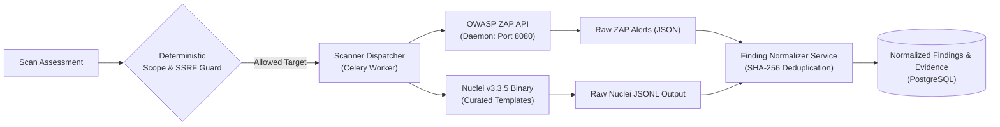

# SecureMind AI — DAST Scanner Integration & Normalization

**Document ID:** `SMAI-SCN-001`  
**Version:** 1.0.0  
**Engines:** OWASP ZAP Daemon (API) & Nuclei v3.3.5 (ProjectDiscovery)  

---

## 1. Scanner Integration Overview

SecureMind AI integrates two complementary open-source dynamic application security testing (DAST) technologies into an automated, rate-limited execution pipeline:



---

## 2. OWASP ZAP Daemon Integration

### Container Configuration
The OWASP ZAP daemon executes inside an isolated container (`softwaresecurity/zap-stable`):
```yaml
zap:
  image: softwaresecurity/zap-stable
  container_name: securemind_zap
  restart: unless-stopped
  command: zap.sh -daemon -host 0.0.0.0 -port 8080 -config api.key=securemind-zap-api-key -config api.addrs.addr.name=.* -config api.addrs.addr.regex=true
  networks:
    - securemind_network
```

### Python API Client (`ZAPScannerService`)
The backend communicates with ZAP via its HTTP API:
1. **Spidering:** `GET /JSON/spider/action/scan/?url=<target>&apikey=<key>` maps all public application paths and links.
2. **Passive Scanning:** `GET /JSON/pscan/view/recordsToScan/?apikey=<key>` polls passive queue until pending records reach 0.
3. **Controlled Active Scanning:** `GET /JSON/ascan/action/scan/?url=<target>&recurse=true&inScopeOnly=true` launches targeted active checks only after human sign-off.
4. **Alert Collection:** `GET /JSON/alert/view/alertsByRisk/?url=<target>&recurse=true` retrieves structured alerts.

---

## 3. Nuclei v3.3.5 Engine Integration

### Container Packaging
Nuclei is packaged directly into the `backend/Dockerfile` as a static Go binary with pinned official community templates:

```dockerfile
# Download official static Nuclei release
RUN wget https://github.com/projectdiscovery/nuclei/releases/download/v3.3.5/nuclei_3.3.5_linux_amd64.zip \
    && unzip nuclei_3.3.5_linux_amd64.zip -d /usr/local/bin/ \
    && rm nuclei_3.3.5_linux_amd64.zip \
    && chmod +x /usr/local/bin/nuclei

# Initialize community templates directory
RUN mkdir -p /app/nuclei-templates \
    && nuclei -update-templates -templates /app/nuclei-templates || true
```

### Subprocess Execution & Sandboxing (`NucleiScannerService`)
The worker executes Nuclei with strict resource and network boundaries:
```python
cmd = [
    'nuclei',
    '-target', target_url,
    '-jsonl',
    '-rate-limit', '15',
    '-timeout', '10',
    '-max-host-error', '5',
    '-t', settings.NUCLEI_TEMPLATES_DIR,
    '-tags', 'cve,misconfiguration,exposure,default-login',
    '-silent'
]
proc = subprocess.run(cmd, capture_output=True, text=True, timeout=300)
```
- **Rate Limiting:** Capped at 15 requests per second to avoid impacting target availability.
- **Subprocess Timeout:** Hard timeout of 300 seconds prevents hanging processes.
- **JSONL Parsing:** Each stdout line is parsed as an individual vulnerability finding object.

---

## 4. Deterministic SSRF and Target Scope Guard

Before any scanner initiates network connections, the target domain is validated against `TargetSafetyValidator`:

```python
def validate_target_safety(domain: str):
    addr_info = socket.getaddrinfo(domain, None)
    for item in addr_info:
        ip = ipaddress.ip_address(item[4][0])
        # Handle IPv6-mapped IPv4 addresses (::ffff:127.0.0.1)
        if isinstance(ip, ipaddress.IPv6Address) and ip.ipv4_mapped:
            ip = ip.ipv4_mapped
        
        if ip.is_loopback:
            raise SecurityScopeError("Target resolves to prohibited loopback address.")
        if ip.is_private and not settings.ALLOW_PRIVATE_IP_SCANS:
            raise SecurityScopeError("Target resolves to prohibited private RFC1918 address.")
        if str(ip) == '169.254.169.254':
            raise SecurityScopeError("Target resolves to prohibited cloud metadata endpoint.")
```

---

## 5. Finding Normalization & Deduplication Pipeline

Diverse outputs from ZAP and Nuclei are mapped into a unified schema:

| Raw Scanner Output | SecureMind AI Finding Model |
|---|---|
| ZAP `alert` / Nuclei `info.name` | `Finding.title` |
| ZAP `risk` / Nuclei `info.severity` | `Finding.severity` (`critical`, `high`, `medium`, `low`) |
| ZAP `cweid` / Nuclei `info.classification.cwe-id` | `Finding.cwe_id` (e.g. `CWE-89`) |
| ZAP `url` / Nuclei `matched-at` | `Finding.affected_url` |
| ZAP `param` / Nuclei extracted query parameter | `Finding.parameter` |

### Deterministic SHA-256 Fingerprinting
To prevent duplicate findings across repeated scans or between multiple scanners, a deterministic fingerprint is computed:

$$\text{Fingerprint} = \text{SHA256}(\text{title} \parallel \text{affected\_url} \parallel \text{parameter})$$

When saving findings:
```python
finding, created = Finding.objects.get_or_create(
    scan=scan,
    fingerprint=fingerprint,
    defaults={...}
)
```
This fingerprint also enables precise assessment diffing and tracking of recurring vs. resolved vulnerabilities over time.
