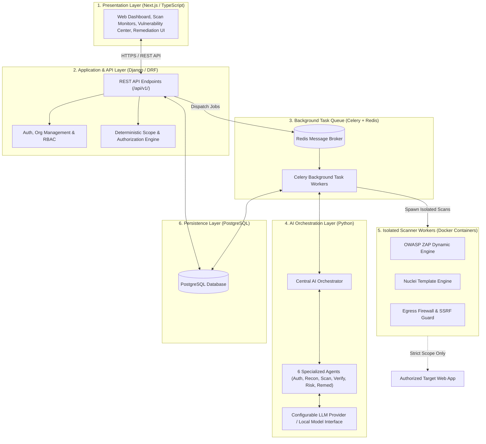
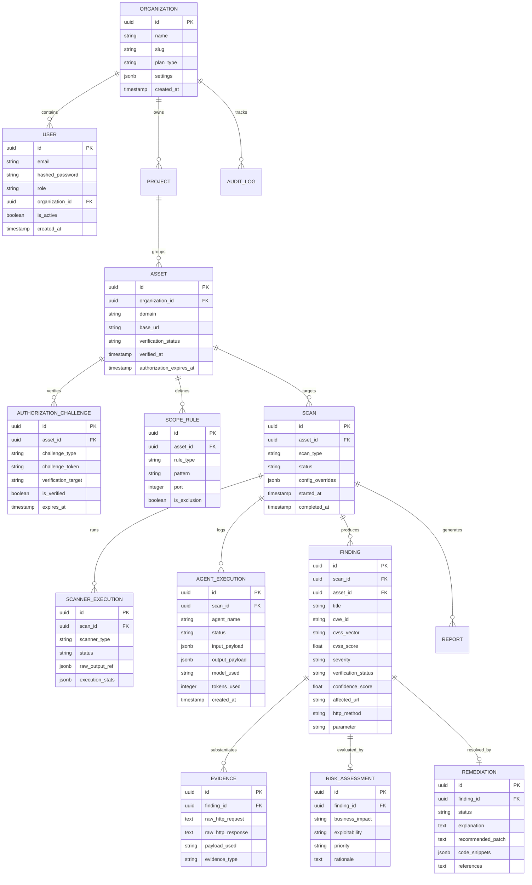
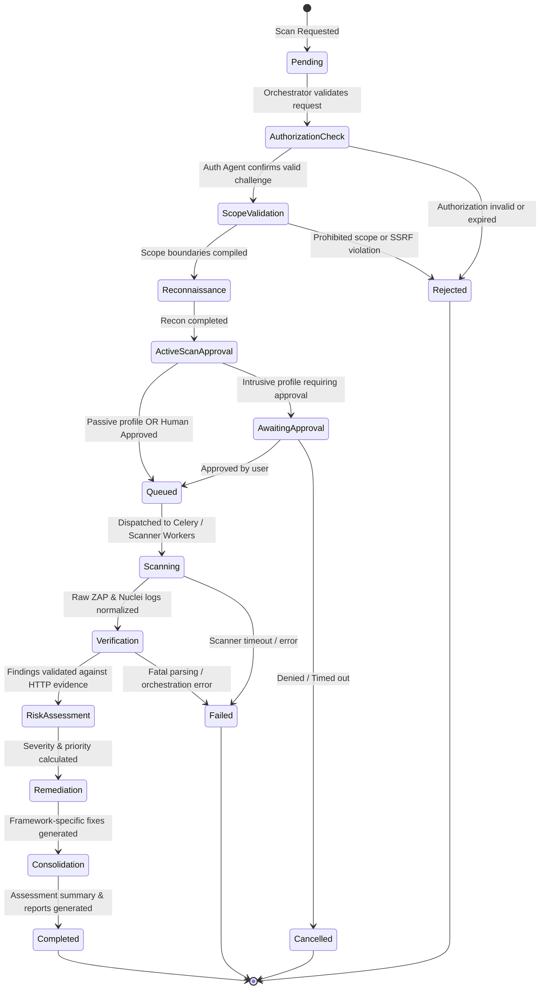

# SecureMind AI — System Architecture Document (SAD)

**Document ID:** SMAI-SAD-001  
**Version:** 1.0  
**Status:** Architecture Baseline  
**Based on:** SRS (`SMAI-SRS-001`) & Project Overview (`SecureMind_AI_Overview.pdf`)  

---

## 1. Executive Summary & Architectural Philosophy

SecureMind AI is an **Agentic AI-driven Web Application Security and Remediation Platform**. Rather than acting as a simple conversational wrapper or replacing existing security scanners, SecureMind AI couples proven security engines (**OWASP ZAP** and **Nuclei**) with a structured multi-agent AI system (**1 Central Orchestrator + 6 Specialized Agents**).

### Core Design Tenets
1. **Deterministic Gates Over AI Decisions:** Scan authorization, target scope boundary checks, and SSRF restrictions are strictly enforced by deterministic backend code and network firewalls. AI agents never have the final say on whether a target is authorized.
2. **Invisible Multi-Agent Orchestration:** Users interact with a clean, cohesive SaaS dashboard (Next.js). The 6 agents operate autonomously within an asynchronous Celery pipeline, surfacing their reasoning as structured metadata, confidence scores, and remediation code.
3. **Evidence-Based Finding Verification:** No finding is marked as confirmed unless corroborated by raw HTTP traffic logs (request/response evidence). The Verification Agent's primary mission is the elimination of false positives.
4. **Actionable Developer Remediation:** The platform translates abstract CVEs and CWEs into framework-specific, copy-pasteable patches and defensive configurations tailored to the detected tech stack.

---

## 2. High-Level System Architecture

The system is separated into seven decoupled layers to guarantee security, fault tolerance, and independent scaling:



---

## 3. Database Schema & Data Model (ER Design)



---

## 4. Orchestrator State Machine & Workflow

Every assessment transitions through an immutable state machine managed by the Central Orchestrator:



---

## 5. Agent Input/Output JSON Contracts

To prevent untrusted data from causing prompt injection or invalid state transitions, each agent operates on strict, schema-validated JSON.

### 5.1 Authorization Agent (`SMAI-AI-AGT-001`)
* **Input Contract:**
```json
{
  "asset_id": "8f3e2b11-9a4c-4d3b-bf88-75c123abc456",
  "target_domain": "example.com",
  "requested_scan_type": "controlled_active",
  "verification_records": [
    {
      "method": "DNS_TXT",
      "token": "securemind-verify-xyz789",
      "verified": true,
      "verified_at": "2026-11-18T08:00:00Z"
    }
  ],
  "defined_scope": {
    "allowed_hosts": ["example.com", "api.example.com"],
    "allowed_ports": [80, 443],
    "excluded_paths": ["/admin/reset-db", "/logout"]
  }
}
```
* **Output Contract:**
```json
{
  "authorization_valid": true,
  "scope_validated": true,
  "requires_human_approval": true,
  "rejection_reason": null,
  "normalized_scope": {
    "include": ["https://example.com/*", "https://api.example.com/*"],
    "exclude": ["https://example.com/admin/reset-db", "https://example.com/logout"]
  }
}
```

### 5.2 Verification Agent (`SMAI-AI-AGT-004`)
* **Input Contract:**
```json
{
  "raw_finding": {
    "scanner": "Nuclei",
    "template_id": "cve-2023-xxxx",
    "title": "Reflected Cross-Site Scripting in search query",
    "target_url": "https://example.com/search?q=%3Cscript%3Ealert(1)%3C/script%3E",
    "http_request": "GET /search?q=%3Cscript%3Ealert(1)%3C/script%3E HTTP/1.1\nHost: example.com...",
    "http_response": "HTTP/1.1 200 OK\nContent-Type: text/html\n\nSearch results for <script>alert(1)</script>..."
  }
}
```
* **Output Contract:**
```json
{
  "verification_status": "Confirmed",
  "confidence_score": 0.95,
  "is_false_positive": false,
  "evidence_analysis": "The probe payload was reflected unescaped directly into the response DOM with a text/html content-type. No sanitization was observed.",
  "verification_notes": "Payload confirmed executing in browser context."
}
```

### 5.3 Remediation Agent (`SMAI-AI-AGT-006`)
* **Input Contract:**
```json
{
  "finding_id": "f47ac10b-58cc-4372-a567-0e02b2c3d479",
  "title": "SQL Injection in User Search",
  "cwe": "CWE-89",
  "tech_stack": {
    "language": "Python",
    "framework": "Django"
  },
  "affected_component": "/api/users/search?filter=..."
}
```
* **Output Contract:**
```json
{
  "explanation": "The endpoint concatenates user input directly into a raw SQL query string instead of utilizing Django's parameterized ORM queries.",
  "recommended_strategy": "Migrate from RawSQL to Django ORM parameterized filtering or use params list.",
  "code_examples": [
    {
      "language": "python",
      "file_hint": "views.py",
      "vulnerable_pattern": "User.objects.raw(f'SELECT * FROM users WHERE name = {user_input}')",
      "secure_replacement": "User.objects.filter(name=user_input) # Automatically parameterized by Django ORM"
    }
  ],
  "references": [
    "https://docs.djangoproject.com/en/stable/topics/security/#sql-injection-protection",
    "https://cwe.mitre.org/data/definitions/89.html"
  ]
}
```

---

## 6. Scanner Isolation & Network Security Architecture

To meet non-functional requirements (`NFR-SEC-007`, `NFR-SEC-008`, `NFR-SEC-013`):

```
┌────────────────────────────────────────────────────────────────────────┐
│                        DOCKER HOST SYSTEM                              │
│                                                                        │
│   ┌─────────────────────┐             ┌────────────────────────────┐   │
│   │   Celery App Node   │             │   Scanner Worker (ZAP)     │   │
│   │                     │             │   Docker Container         │   │
│   └──────────┬──────────┘             └─────────────┬──────────────┘   │
│              │                                      │                  │
│              │ Internal Docker Network              │ Isolated Bridge  │
│              ▼                                      ▼                  │
│   ┌────────────────────────────────────────────────────────────┐       │
│   │               EGRESS PROXY / IPTABLES FILTER               │       │
│   │                                                            │       │
│   │  - Blocks 10.0.0.0/8, 172.16.0.0/12, 192.168.0.0/16       │       │
│   │  - Blocks 127.0.0.0/8 (Loopback)                           │       │
│   │  - Blocks 169.254.169.254 (Cloud Instance Metadata Service)│       │
│   │  - Only permits TCP ports 80, 443 to verified targets      │       │
│   └─────────────────────────────┬──────────────────────────────┘       │
│                                 │                                      │
└─────────────────────────────────┼──────────────────────────────────────┘
                                  ▼
                        PUBLIC INTERNET TARGET
```

* **SSRF Guarding:** Any target resolving to a private or loopback IP is blocked at both the API level and the egress proxy level before any scanner process is spawned.
* **Ephemeral Workspaces:** Scanner containers run with read-only root filesystems and write raw findings to a transient volume, destroyed immediately after findings are parsed and normalized.

---

## 7. REST API Route Structure

All endpoints reside under `/api/v1/` and enforce JWT authentication and RBAC:

* **Authentication & Identity:**
  - `POST /api/v1/auth/register/`
  - `POST /api/v1/auth/login/`
  - `POST /api/v1/auth/refresh/`
  - `GET /api/v1/auth/me/`
* **Organizations & Projects:**
  - `GET/POST /api/v1/organizations/`
  - `GET/POST /api/v1/organizations/{id}/members/`
  - `GET/POST /api/v1/projects/`
* **Assets & Scope Authorization:**
  - `GET/POST /api/v1/assets/`
  - `POST /api/v1/assets/{id}/challenge/` (Generates DNS TXT / HTTP challenge)
  - `POST /api/v1/assets/{id}/verify/` (Triggers backend ownership verification)
  - `GET/POST /api/v1/assets/{id}/scope-rules/`
* **Scans & AI Workflow:**
  - `GET/POST /api/v1/scans/`
  - `GET /api/v1/scans/{id}/status/` (Live polling / WebSocket stream)
  - `POST /api/v1/scans/{id}/cancel/`
  - `POST /api/v1/scans/{id}/approve/` (Human-in-the-loop sign-off)
* **Vulnerabilities & Evidence:**
  - `GET /api/v1/findings/` (Filters: severity, status, asset)
  - `GET /api/v1/findings/{id}/`
  - `GET /api/v1/findings/{id}/evidence/`
  - `PATCH /api/v1/findings/{id}/status/` (Open, In Progress, Fixed, False Positive)
* **Remediation & Reports:**
  - `GET /api/v1/findings/{id}/remediation/`
  - `POST /api/v1/reports/generate/`
  - `GET /api/v1/reports/{id}/download/`

---

## 8. Development Implementation Roadmap

Following the 12 phases outlined in the project blueprint:

1. **Phase 1: Architecture Baseline & Environment** (Complete with this SAD).
2. **Phase 2: Django Backend Foundation & Models** (PostgreSQL schema, migrations, base models).
3. **Phase 3: Auth, RBAC & Multi-Tenancy** (Custom user model, org tenant isolation).
4. **Phase 4: Asset Registration & Verification Engine** (DNS TXT & HTTP token verification).
5. **Phase 5: Secure Scanner Worker Sandbox** (Docker, Celery, SSRF egress rules).
6. **Phase 6: OWASP ZAP & Nuclei Engine Integrations** (Wrappers & output normalizers).
7. **Phase 7: Central Orchestrator & 6 Specialized Agents** (Python agent engine, prompts, JSON schemas).
8. **Phase 8: Finding Normalization, Evidence & Risk Scoring** (Deduplication, CVSS/CWE).
9. **Phase 9: AI Remediation & PDF Reporting** (Fix generation, WeasyPrint/report generation).
10. **Phase 10: Next.js Frontend Dashboard** (Interactive UI, scan status, finding explorer).
11. **Phase 11: Security Hardening & Penetration Testing** (Audit logs, rate limiting, defensive checks).
12. **Phase 12: Production Packaging** (Docker Compose for self-hosted and cloud SaaS).
